# ZMP 기반 모바일 로봇 전복 방지 (Unity)

ZMP(Zero Moment Point)로 모바일 로봇의 전복 위험을 실시간으로 계산하고, 위험도에 따라 모터 토크와 조향 속도를 줄여 전복을 막는 알고리즘을 Unity 시뮬레이션으로 구현한 프로젝트입니다.

경희대학교 기계공학부 2024 캡스톤디자인(지도교수 임성수) 2조 프로젝트이자 학사학위논문 **「모바일 로봇 전복 위험 구역 계산과 전복 방지를 위한 구역 내 제어」** 의 구현 코드입니다. 논문 원문은 [docs/bachelor_thesis.pdf](docs/bachelor_thesis.pdf)에 있습니다.

| 전복 방지 제어 없음 (실험 A) | 전복 방지 제어 적용 (실험 B) |
|:---:|:---:|
| 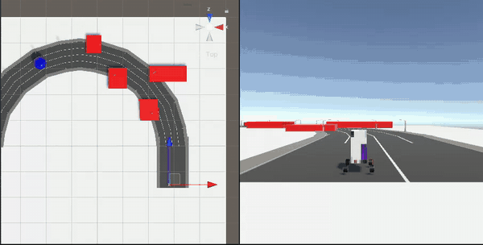 | 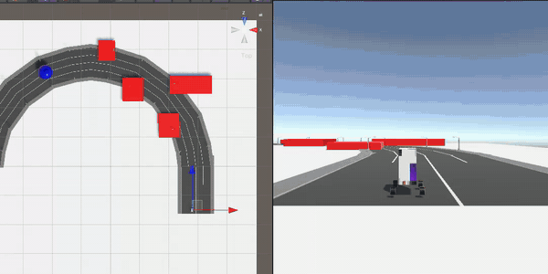 |
| 급선회 구간에서 우측으로 전복 | 감속과 완만한 조향으로 끝까지 주행 |

> GIF는 각각 2배속, 3배속입니다.

## 개요

- **경로 생성**: A\* 알고리즘. 장애물 주변 비용을 Box Blur로 평활화해 급격하게 꺾이는 경로를 줄였습니다.
- **경로 추종**: 횡단 오차(CTE) 기반 PD 제어로 전륜 조향각을 계산합니다.
- **전복 판단**: 매 프레임 로봇의 자세(roll·pitch·yaw), 각속도, 가속도로 ZMP를 구하고, 이를 전복 안정성 지표 TSI(Turnover Stability Index)로 바꿉니다.
- **전복 방지 제어**: TSI가 낮아질수록 모터 토크와 조향 속도를 단계적으로 줄입니다.

<p align="center">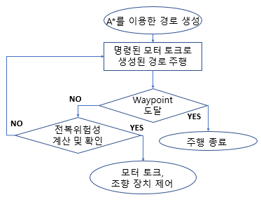</p>

## 방법

### 1. ZMP

ZMP는 지지면 위에서 로봇의 관성력과 중력이 만드는 모멘트의 합이 0이 되는 점입니다. 바퀴가 지면에 닿는 점들을 이은 영역(Projection Polygon) 안에 ZMP가 있으면 안정, 밖으로 나가면 전복 가능성이 있는 상태로 봅니다.

<p align="center">
  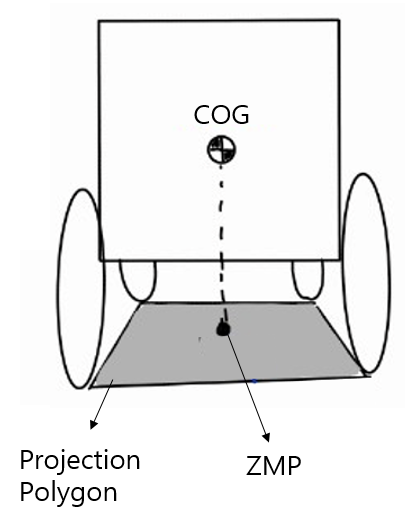
  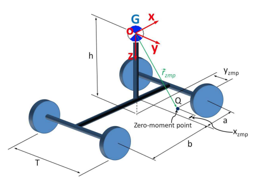
</p>

로봇을 바퀴 4개짜리 강체(Rigid Vehicle Model)로 가정하고, D'Alembert 원리로 세운 모멘트 방정식에서 ZMP 좌표 $(x_{zmp}, y_{zmp})$ 를 구했습니다. 식에는 질량, 무게중심 높이 $h$, 관성모멘트 $I_{xx}, I_{yy}, I_{zz}$, 자세각, 각속도 $p, q, r$, 각가속도 $\alpha_x, \alpha_y$, 무게중심 가속도 $a_{Gx}, a_{Gy}$, 지형 roll 각이 들어갑니다. 이 ZMP에 roll·pitch·yaw 회전행렬을 곱한 것을 Modified ZMP라고 부릅니다. 전체 식은 논문 식 (2)~(8)에 있습니다.

### 2. 전복 안정성 지표 (TSI)

Projection Polygon을 지면 좌표계에 투영한 영역(Turnover Stability Space)의 경계 $X_u, X_l, Y_u, Y_l$ 과 Modified ZMP 사이 거리로 지표를 정의합니다 (Lee et al., 2009).

```math
S_{au} = \frac{1}{2}\left\lbrace 1 - \frac{g}{a_{max} h}\left(ZMP_x - X_u\right)\right\rbrace ,\qquad
S_{al} = \frac{1}{2}\left\lbrace 1 + \frac{g}{a_{max} h}\left(ZMP_x - X_l\right)\right\rbrace
```

```math
S_{wu} = \frac{1}{2}\left\lbrace 1 - \frac{g}{(v\omega)_{max} h}\left(ZMP_y - Y_u\right)\right\rbrace ,\qquad
S_{wl} = \frac{1}{2}\left\lbrace 1 + \frac{g}{(v\omega)_{max} h}\left(ZMP_y - Y_l\right)\right\rbrace
```

```math
S_a = \min(S_{au}, S_{al}),\qquad S_w = \min(S_{wu}, S_{wl})
```

<p align="center">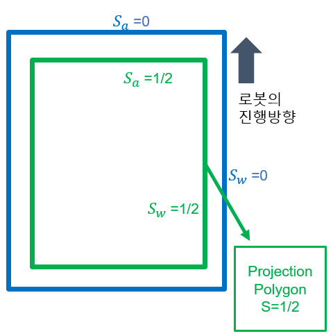</p>

- $S_a$ 는 전후 방향(선가속도), $S_w$ 는 좌우 방향(속도 × 회전 각속도, 즉 구심가속도)의 여유를 나타냅니다.
- ZMP가 지지 영역 경계에 있으면 $S = 1/2$ 입니다. 이보다 작으면 ZMP가 지지 영역 밖에 있다는 뜻입니다.
- $S_{wu}$ < 0 이면 좌측, $S_{wl}$ < 0 이면 우측으로 넘어질 가능성이 큽니다.

### 3. 전복 방지 제어

급선회 구간에서는 좌우 방향 지표 $S_w$ 가 먼저 떨어집니다. 그래서 $S_{wu}$, $S_{wl}$ 에 따라 단계별로 제어합니다.

| 조건 | 모터 토크 | 조향 속도 감소 |
|---|---|---|
| $S_{wu}$ 또는 $S_{wl}$ < 0.6 | 20% 감소 | 10% |
| $S_{wu}$ 또는 $S_{wl}$ < 0.5 | 45% 감소 | 15% |
| $S_{wu}$ 또는 $S_{wl}$ < 0.2 | 60% 감소 | 20% |
| $S_{wu}$ 또는 $S_{wl}$ < 0 | 400으로 제한 (약 1.4 m/s) | 25% |

조향 속도는 목표 조향각을 바로 적용하지 않고 이전 값과 평균하는 비율을 키우는 방식으로 줄였습니다.

### 4. 경로 계획과 추종

<p align="center">
  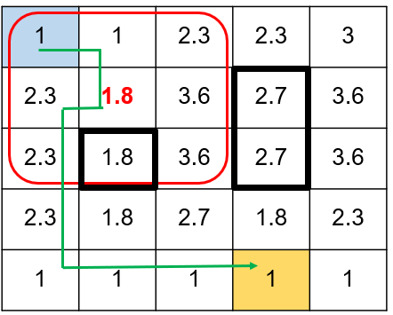
  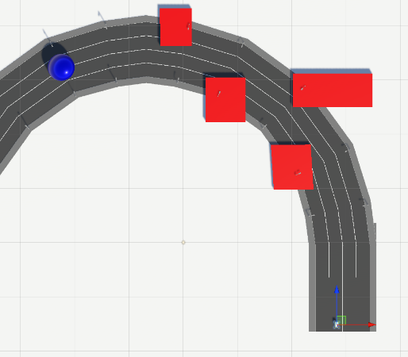
</p>

- A\* 휴리스틱은 상하좌우 이동에 Manhattan, 대각 이동에 Euclidean 거리를 썼습니다 (이동 비용 10 / 14).
- 장애물 근처 노드의 비용을 주변 노드 평균으로 다시 매겨(Box Blur), 경로가 장애물 옆에서 급하게 꺾이지 않도록 했습니다.
- 경로 추종은 이전·현재 waypoint를 잇는 선분과 로봇 사이의 CTE를 PD 제어기에 넣어 조향각을 계산합니다.

## 시뮬레이션 설정

시험 경로는 장애물 4개가 놓인 U자 커브길입니다. 모터 토크는 1000으로 설정했고, 이때 속도는 약 4 m/s입니다.

| 항목 | 값 |
|---|---|
| 몸체 (L × W × H) | 1 × 0.8 × 1.35 m |
| 질량 | 100 kg |
| 바퀴 (반지름 / 너비 / 질량) | 0.15 m / 0.08 m / 5 kg |
| 서스펜션 (스프링 / 댐퍼) | 3000 N/m / 1000 N·s/m |
| 전방 마찰 (extremum slip / value, asymptote slip / value) | 0.1 / 2, 0.2 / 1.5 |

<p align="center">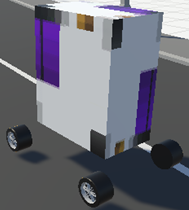</p>

## 결과

| | 실험 A (제어 없음) | 실험 B (전복 방지 제어) |
|---|---|---|
| 주행 속도 | 위험과 무관하게 약 3~4 m/s | 위험 구간에서 감속 |
| 최대 회전 속도 | 약 117 deg/s | 약 76 deg/s |
| 30 step 동안 최대 회전 변화 | 약 230 deg | 약 72 deg |
| $S_w$ 최솟값 | 약 −30 | 약 −0.07 |
| 결과 | 급선회 구간에서 우측으로 전복 | 전복 없이 주행 |

| 속도 | 회전 속도 |
|:---:|:---:|
| 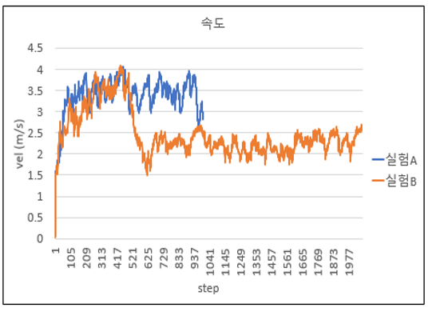 | 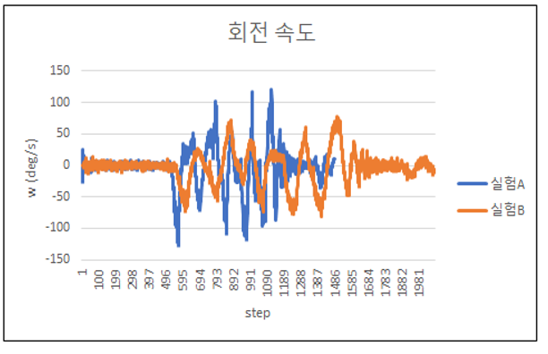 |

| TSI, 실험 A | TSI, 실험 B |
|:---:|:---:|
| 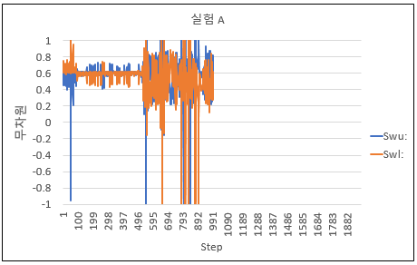 | 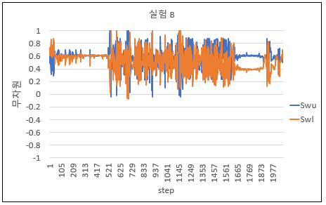 |
| 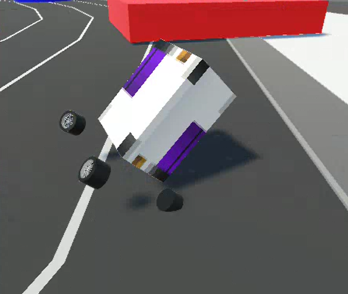 | 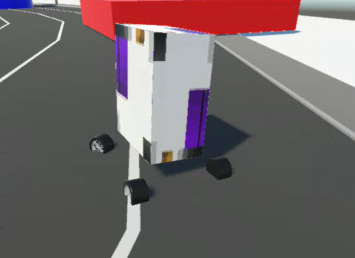 |

## 실행 방법

1. Unity **2021.3.36f1** 로 이 폴더를 엽니다.
2. `Assets/Scenes/turnover_project.unity` 씬을 열고 Play를 누릅니다.
3. 로봇 오브젝트의 `Robot_turnoverPIDController` 컴포넌트에서 PD 게인, 모터 토크, 로그 파일 경로(`filePath`, `filePath2`, `filePath3`)를 바꿀 수 있습니다. 로그 경로 기본값은 작성자 PC 경로이므로 먼저 수정해야 합니다.

## 코드 구조

```
Assets/
├── Scenes/turnover_project.unity           # 전복 방지 시뮬레이션 씬
└── Scripts/turn_over_project/
    ├── Robot_turnoverPIDController.cs      # 주행, ZMP·TSI 계산, 전복 방지 제어, 로그 기록
    ├── PIDController.cs                    # CTE 기반 조향 제어기
    ├── CustomMath.cs                       # CTE, 조향 방향, waypoint 통과 판정
    ├── Grid.cs / Node.cs / Heap.cs         # A* Grid (Box Blur 비용 평활화 포함)
    ├── Pathfinding.cs / PathRequestManager.cs
    └── Unit.cs / AstarRobotController.cs
0617/                                        # 실험 로그 (자세, 속도·가속도·각속도, Swu·Swl)
```

`Robot_turnoverPIDController.cs`에서 주요 함수는 다음과 같습니다.

| 함수 | 역할 |
|---|---|
| `my_S_Test()` | ZMP, Modified ZMP, TSI($S_{au}, S_{al}, S_{wu}, S_{wl}$) 계산 |
| `turnover_void()` | TSI로 위험 단계 판정 |
| `Move()` | 위험 단계에 따라 모터 토크 조절 |
| `Steer()` | PD 조향각 계산과 위험 단계별 조향 평활화 |
| `LogRobotData()` | 자세, 속도·가속도·각속도, TSI를 텍스트 파일로 기록 |

ZMP·TSI 식을 먼저 검토할 때 쓴 MATLAB 코드는 [2024Capstone](https://github.com/ukhyeon/2024Capstone)의 `ZMP_Calculation/`에 있습니다. 이 저장소에는 프로젝트가 끝난 뒤 같은 Unity 환경에서 개인 프로젝트로 진행한 경로계획 알고리즘(Bug, Dijkstra, A\*, RRT, RRT\*) 시각화 씬도 들어 있습니다. 이 부분은 [unity-mobile-robot-path-planning](https://github.com/ukhyeon/unity-mobile-robot-path-planning)으로 따로 분리했습니다.

## 팀

| 이름 | 담당 |
|---|---|
| 김현욱 | Unity 시뮬레이션, PD 제어 |
| 이장호 | ZMP·TSI 이론 정리, MATLAB 계산 |
| 박연수 | A\* 경로계획 |

지도교수: 임성수 (경희대학교 기계공학부)

## 참고문헌

1. S. Lapapong, "Vehicle rollover prediction for banked surfaces," The Pennsylvania State University, 2010.
2. H. Zhang, W. Lin, and A. Chen, "Path Planning for the Mobile Robot: A Review," *Symmetry*, vol. 10, no. 10, p. 450, 2018.
3. J. H. Lee, J. B. Park, and B. H. Lee, "Turnover prevention of a mobile robot on uneven terrain using the concept of stability space," *Robotica*, vol. 27, no. 5, pp. 641–652, 2009.
